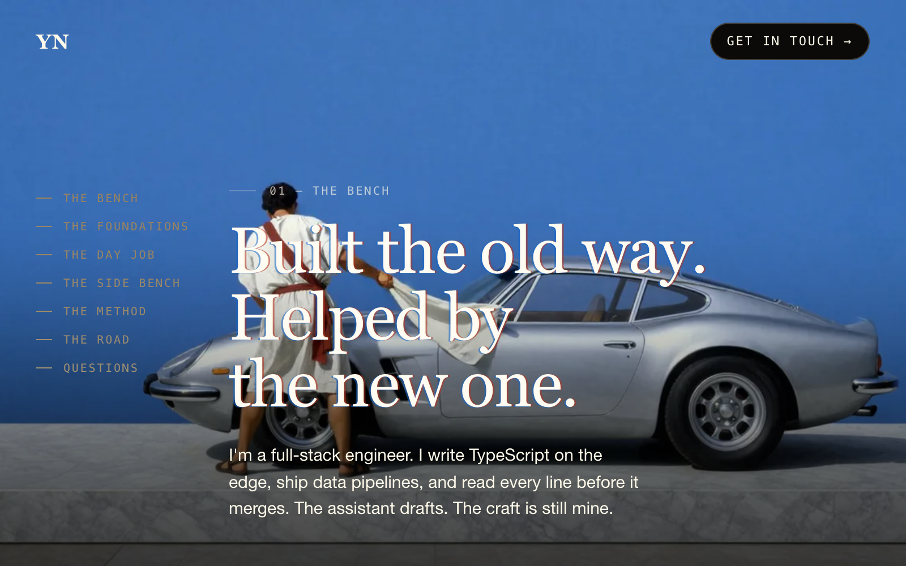
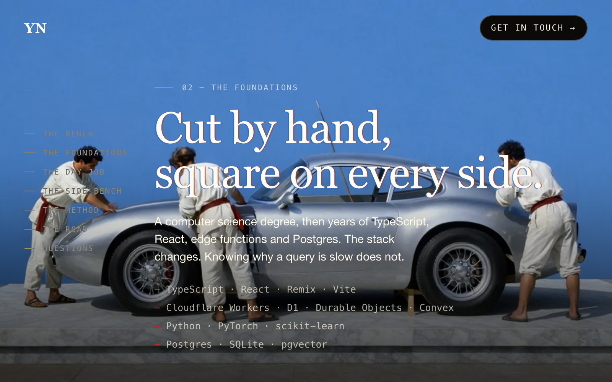
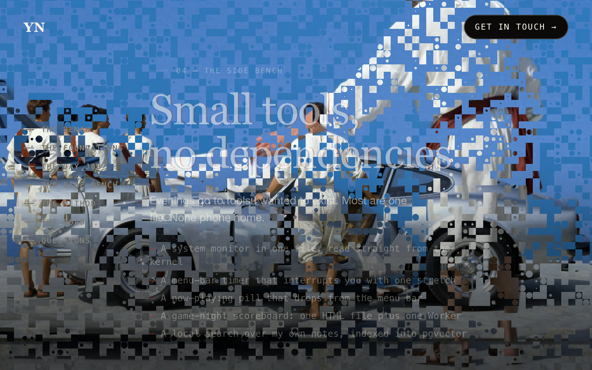
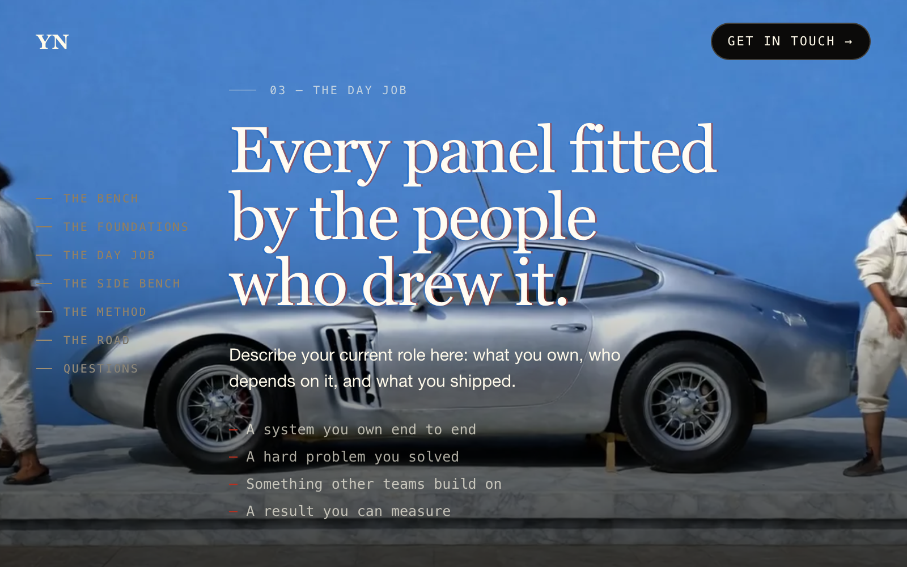
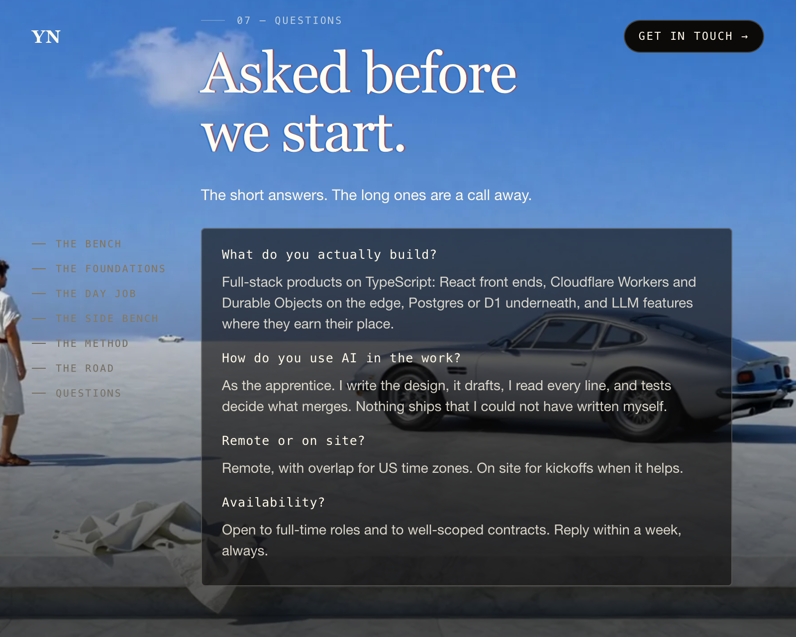

# Scroll Film Portfolio

A one-page portfolio that plays as a short film while you scroll: a silver car built by hand on a marble plinth, shot by shot, joined by particle dissolves. Plain HTML, CSS and one WebGL2 shader, built with Vite. Every frame of art was generated on a laptop with open models, and the page makes no external requests.



## Why

Portfolio templates tend to be a grid of cards or a hero video that autoplays and ignores you. Scroll-scrubbed film sites (the kind where scrolling drives the footage) feel better but usually ship a megabyte of animation library, a CDN of video, and a tracking script. This one does it with one canvas, a 40-line fragment shader and a JSON file, and the story is told with hands and objects because local video models still drift on faces.

## What it does

- **Scroll is the playhead** — each shot gets three screen-heights of scroll. Frames scrub over the first 72 %, a dot-cell particle dissolve into the next shot runs over the last 20 %, and the camera dollies in 6 % as you go.
- **Continuous takes** — shots marked `continuous` start on the last frame of the previous clip, so the engine hard-cuts instead of dissolving and the scene reads as one take.
- **Three openers** — one of `open-drape`, `open-polish`, `open-crowd` is picked per visit (or forced with `?open=open-drape`), plays once when its frames arrive, then holds.
- **Memory-bounded** — only the current shot and its neighbours stay decoded as `ImageBitmap`s; everything further away is closed. Missing frames fall back to the shot's still, and a missing still falls back to a blue sky.
- **Copy as data** — seven chapters, their headlines, bullet lists and Q&A live in `content.json` and ride on shots. Headlines get a two-colour letterpress misregistration in CSS.
- **Degrades politely** — without WebGL2 the chapters become static sections over the stills; with `prefers-reduced-motion` the film holds still, skips the dolly and cuts instantly.
- **A test that means something** — `npm test` builds the site and fails if a chapter or shot is missing from the bundle or any `http(s)` URL other than GitHub or LinkedIn appears in it.

## Screenshots

| | |
|---|---|
|  |  |
| Chapter | Dissolve |
|  |  |
| Lists | Questions |

*All imagery is generated by the pipeline in `art/` (Z-Image-Turbo stills, Wan 2.2 clips) — no photographs of real people. The copy is placeholder text; put your own in `content.local.json`.*

## Quick start

Requires Node 18+.

```sh
npm install
npm run dev        # http://localhost:5757
npm test           # build + bundle checks
```

A fresh clone has the 13 poster stills (2.5 MB) but not the scrubbed frame sequences (about 57 MB of WebP), so the page shows each shot as a still with the dissolves between them. To get the moving film, render the clips with the art pipeline — see [docs/BUILDING.md](docs/BUILDING.md#rendering-the-film).

To make it yours, create `content.local.json` with any top-level keys you want to replace — `name`, `title`, `mark`, `email`, `links`, `chapters`. It is git-ignored and wins over `content.json`.

## Requirements

| | |
|---|---|
| Runtime | Node 18+ for Vite 6; the built site is static files |
| Browser | WebGL2 for the film; anything else gets static chapters over the stills |
| Art pipeline | Apple silicon Mac, `mflux` and `mlx-gen`, ffmpeg, ~35 GB of model downloads |
| Without the frames | Works; stills and dissolves only |

## How it's organised

```
index.html            page shell: header, chapter rail, canvas, footer
src/main.js           builds chapters from content, maps scroll to shot progress, fades copy
src/scene.js          WebGL2 renderer: frame scrubbing, dissolve shader, frame loading
src/style.css         type, layout, letterpress headlines, reduced-motion rules
content.json          placeholder copy, shot order, frame counts, continuous shots
check.mjs             npm test: build and assert on the bundle
public/films/         <shot>.jpg posters (committed), <shot>/f_NNN.webp frames (generated)
art/                  prompts, styles and scripts for stills, clips and frames
prompts.md            the story and the generation notes
Tools/screenshots.mjs regenerates docs/screenshots in headless Chrome
```

[docs/ARCHITECTURE.md](docs/ARCHITECTURE.md) explains how the film engine works; [docs/BUILDING.md](docs/BUILDING.md) covers running, rendering and extending it.

## Contributing

Pull requests are welcome.

- Run `npm test` before sending anything; it catches a renamed shot or a stray external URL.
- To add a shot, add its prompt to `art/car/prompts.txt` and `art/car/motion.txt`, render it, and add its id to `shots` and a chapter in `content.json`.
- Never commit rendered frames, clips or your own photos; only posters under `public/films/*.jpg` are tracked.
- Good first projects: streaming frames from a single video instead of WebP files, a keyboard shortcut per chapter, a print stylesheet.

## Credits and licence

Scroll Film Portfolio is MIT licensed — see [LICENSE](LICENSE).

- Fraunces, Geist and Geist Mono via [Fontsource](https://fontsource.org) — SIL Open Font License 1.1.
- [Vite](https://vite.dev) — MIT.
- Stills: [Z-Image-Turbo](https://huggingface.co/Tongyi-MAI/Z-Image-Turbo) via [mflux](https://github.com/filipstrand/mflux). Clips: Wan 2.2 TI2V-5B via mlx-gen. Check each model's licence before reusing generated output commercially.
- The structure of the film (opener, story shots, dissolves, footer loop) is inspired by scroll-driven sites such as pear.no. The painting style prompts name Jacques-Louis David, William Bouguereau and Magritte as references; no artwork of theirs is included.
